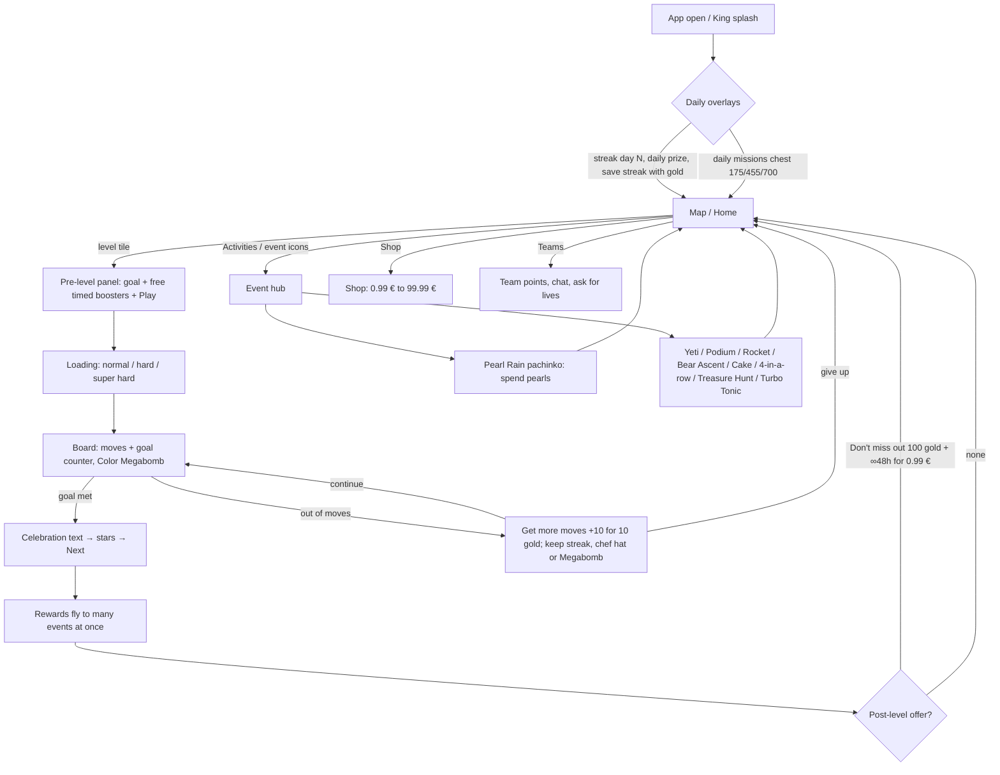

# Candy Crush Soda — Selection Study and Reconstructed Player Loop

Date: 2026-10-27. Source: the 592 frames Victoria retained across 7 recordings
(`data/soda-approved-frames/20261027T183800531125Z/manifest.json`).
Method: visual review of every retained frame through 28 contact sheets plus
timing metrics derived from frame timestamps.

## 1. Scope and limits

- Evidence is only the retained frames. The unselected frames were physically
  deleted after curation and cannot be re-inspected.
- The recordings are separate sessions, not one continuous journey.
- Frames show screens and offers. They do **not** prove taps, purchases or
  causality. Currency changes (for example gold bars 6397 → 6338 → 6300) are
  consistent with spending but are not a verified transaction.
- UI text is Spanish; labels below are descriptive translations.
- Gaps in selection (V2, V4) mean "not selected", not "not played".

## 2. What the selection itself teaches (curation learnings)

| Video | Recording | Kept | Duration | Kept/min | Median gap | Gaps ≤1.5 s | Gaps >2 min |
|---|---|---:|---:|---:|---:|---:|---|
| V1 | 10-15 11:59 | 22 | 160 s | 8.2 | 2.5 s | 7 | — |
| V2 | 10-15 12:07 | 27 | 963 s | 1.7 | 2.6 s | 8 | 461→603 s, 603→952 s |
| V3 | 10-15 14:05 | 8 | 42 s | 11.5 | 1.0 s | 4 | — |
| V4 | 10-15 18:27 | 55 | 966 s | 3.4 | 2.1 s | 19 | 443→680 s |
| V5 | 10-15 20:20 | 66 | 301 s | 13.2 | 1.0 s | 43 | — |
| V6 | 10-18 20:57 | 82 | 316 s | 15.6 | 2.0 s | 33 | — |
| V7 | 10-21 17:29 | 332 | 1611 s | 12.4 | 1.0 s | 201 | — |

Inferred selection rules (consistent across videos, increasingly strict over time):

1. **First appearance wins.** The first time a screen, event or tutorial appears
   it is kept, and later identical repeats are dropped.
2. **State transitions are kept as sequences.** When a counter or progress
   element changes, Victoria keeps the frames before, during and after the change
   (for example the podium animation in about 9 frames, voucher by voucher in the
   golden offer, and the bear ladder rising).
3. **Tutorials are kept step by step** (Pearl Rain spring and bumpers, Yeti
   rules, 4-in-a-row mission swap).
4. **Gameplay is sampled, not recorded.** Each level keeps a few boards (start,
   booster use, celebration), and long stretches of plain matching are skipped.
   That is why V2 and V4 have large gaps.
5. **Scrolling surfaces are captured completely.** The shop and the activity
   lists are kept in several frames so that every offer is visible.
6. **Every distinct loading or difficulty screen is kept** (King splash, hard
   level with a blue skull, super hard level with a gold skull).
7. **Granularity grew from about 2–8 kept frames per minute (V1, V2 and V4) to
   12–16 per minute (V5–V7)**, and most later gaps are 1 s or less. The criterion
   moved from "one per screen" to "one per state change".

Implication for automated pre-selection: score candidates by *UI state change*
(counter, modal, or event panel differs) rather than by visual difference alone,
and always keep the first instance of each new screen type.

## 3. Reconstructed player loop

Observed core cycle: **map → pre-level → play → celebrate → rewards spread
across concurrent events → (optional offer) → map**, interleaved with visits to
the event hub to claim rewards or spend accumulated currencies (pearls).

## 4. Session archetypes per recording

Level numbers below come from visible map tiles.

- **V1. Early-progression snapshot (map at levels 262–264).** This is the only
  recording far from the 20000 range, which suggests a different account or
  profile (not verified). The kept frames show onboarding-style overlays and the
  basic loop.
- **V2. Team cake context.** It shows the team cake and the "Supersonic lollipop
  0/5" challenge, with long periods of play that were not selected.
- **V3. Short look at the milestone (map 19996–19999 → 20000 tile).**
  Eight frames around the approach to the milestone.
- **V4. After the milestone (map 20001–20003).** It shows the "Level
  milestone!", "What mastery!" reward reveal, a 5.99 € milestone offer and a
  0.99 € golden offer.
- **V5. Mastery portal (map 20633–20635 next to a portal door).** It shows the
  mastery portal welcome and "Out of fuel" fail state, then the event meta.
- **V6. Systems and shop tour (map 20634–20636).** It shows event panels,
  teams and a complete scroll through the shop.
- **V7. Long session (about 20 levels, 20638 → 20653).** Almost every event is
  active: Yeti matchmaking and elimination, podium, Pearl Rain tutorials,
  Turbo Tonic, golden offer vouchers, Bear Ascent, cake ending ("Time's up! The
  bakery is closed") and Brain Training.

Reconstructed player profile (interpretation): an endgame player (level 20000+)
plays short levels in batches, always accepts free timed boosters, checks
Activities between levels to claim progress, spends pearls in Pearl Rain, and
opens or browses the shop. The retained frames do not show a confirmed purchase.

## 5. Concrete design and monetization learnings

1. **One level feeds many systems.** After each win, rewards are distributed to
   up to about 8 concurrent events (cake, yeti, podium, rocket, bear, pearls,
   4-in-a-row, team). Each level therefore advances several goals at once, which
   is the main retention lever observed.
2. **Streak economy everywhere.** Daily streak, rainbow lightning streak
   (40 → 69), Yeti 10-level streak, podium streak and Turbo Tonic multiplier
   (x1–x10). Losing threatens several streaks at once, which raises the value
   of a "continue" offer.
3. **The fail state is the main gold sink.** "+10 moves for 10 gold" is
   framed as keeping the chef hat, Megabomb or streak, not only as extra moves.
4. **Offers are timed to emotional peaks.** A milestone offer appears after
   level 20000, and "Don't miss out" appears after level sessions. Starter-price
   anchors of 0.99 € coexist with a 99.99 € top tier.
5. **Social pressure is asynchronous.** It comes from 5-player races (rocket),
   a 3-player real-time podium, Yeti elimination ("fewer rivals means a bigger
   prize", x10 split among 11 winners), team points and an 825-point team goal.
6. **Free timed boosters (∞ N min) reduce friction** and make players
   comfortable with boosters before the paid versions.
7. **Endgame content is kept fresh through modes, not new mechanics.** The
   mastery portal, super hard skulls and level milestones create variety at
   level 20000+.

## 6. QA observations

- **V5 frame #6579.** The "Out of fuel" screen shows the visible placeholder
  "Text goes here". This is a likely localization or content bug and is a
  candidate for a QA-Jira ticket.
- **V7 frame #18264.** The iOS notification center overlay ("Do Not Disturb")
  appears in the frame. It is a recording artifact, not a game issue.

## 7. Open questions

- Is V1 another account or a reset profile? The map shows 262–264 instead of
  20000+.
- Which offers were actually purchased, if any? This needs store receipts or
  telemetry, not frames.
- How long is play between selected frames in the V2 and V4 gaps? The
  unselected footage was deleted.
- What is the reward split per event after each level? A frame-by-frame
  counter audit on V7 would quantify it.
